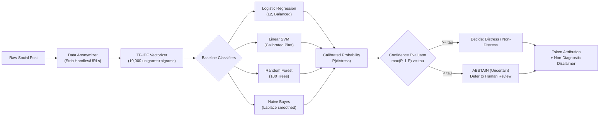

# Responsible Classifier for Detecting Distress-Related Language in Anonymized Online Posts

[](https://www.python.org/)
[](https://fastapi.tiangolo.com/)
[](https://react.dev/)
[](https://vitejs.dev/)
[](https://scikit-learn.org/)
[](https://pytorch.org/)
[](https://shap.readthedocs.io/)
[](https://opensource.org/licenses/MIT)

An end-to-end machine learning system and full-stack web application designed to detect statistical distress-related language in anonymized social media posts (Dreaddit dataset). Built with a foundational emphasis on **Responsible AI**, the system features probability calibration, confidence-based selective abstention to prevent forced errors on ambiguous text, transparent token attribution, and strict non-diagnostic clinical framing.

---

## 📑 Table of Contents

- [📌 Problem Statement & Responsible AI Mandate](#-problem-statement--responsible-ai-mandate)
- [✨ Key System Features](#-key-system-features)
- [⚙️ System Requirements & Prerequisites](#️-system-requirements--prerequisites)
- [🚀 How to Run the Project](#-how-to-run-the-project)
  - [1. Environment Setup](#1-environment-setup)
  - [2. Frontend Setup & Build](#2-frontend-setup--build)
  - [3. Dataset Preparation](#3-dataset-preparation)
  - [4. Running the Machine Learning Pipeline](#4-running-the-machine-learning-pipeline)
  - [5. Running the Full-Stack Web Application](#5-running-the-full-stack-web-application)
    - [Mode A: Unified Full-Stack (Single Port - Recommended)](#mode-a-unified-full-stack-single-port---recommended)
    - [Mode B: Development Mode (Vite Hot-Reload)](#mode-b-development-mode-vite-hot-reload)
  - [6. Running Unit & Integration Tests](#6-running-unit--integration-tests)
  - [7. Interactive Jupyter Notebooks](#7-interactive-jupyter-notebooks)
- [📂 Project Directory Structure](#-project-directory-structure)
- [🔬 Models & Methodological Pipeline](#-models--methodological-pipeline)
- [📊 Model Benchmark Results](#-model-benchmark-results)
- [🛡️ Uncertainty Handling & Selective Abstention](#️-uncertainty-handling--selective-abstention)
- [🌐 REST API Documentation](#-rest-api-documentation)
- [⚖️ Ethical Principles, Privacy & Non-Diagnostic Disclosure](#️-ethical-principles-privacy--non-diagnostic-disclosure)

---

## 📌 Problem Statement & Responsible AI Mandate

Online forums frequently contain self-disclosures conveying acute emotional distress, chronic anxiety, burnout, or low mood. While automated text processing can assist in academic research and content moderation, naive classifiers deployed in high-stakes domains suffer from critical vulnerabilities:

1. **Clinical Overclaiming:** Treating statistical keyword classification as an automated "mental health diagnosis" or clinical profiling, when text alone cannot establish medical diagnoses.
2. **Uncalibrated Probabilities:** High-confidence outputs on ambiguous language, creating false certainty.
3. **Absence of Abstention:** Forcing binary decisions ($0$ or $1$) on edge cases rather than deferring to human review.
4. **False-Positive Stigmatization:** Mislabeling casual venting, colloquial hyperbole ("this traffic is killing me"), or technical frustration as clinical distress.
5. **Opaque Interpretations:** Black-box predictions without phrase-level or token-level accountability.
6. **Privacy Risks:** Unchecked ingestion of usernames, community identifiers, and personal links.

> ### 🛑 Responsible AI Mandate
> This application is **strictly non-diagnostic**. It identifies statistical linguistic markers in anonymized text, outputs calibrated probabilities, abstains whenever confidence falls below a safety threshold, and presents token attributions with cautious linguistic disclaimers. It is not a medical device and should never replace qualified human support.

---

## ✨ Key System Features

- **4 Comparative Baseline Classifiers:**
  - **Logistic Regression** (L2-regularized, balanced class weighting, highly interpretable)
  - **Linear SVM** (Calibrated with 5-fold cross-validation Platt scaling, maximum margin)
  - **Random Forest** (Non-linear ensemble of 100 bagged trees over feature subsets)
  - **Multinomial Naive Bayes** (Frequency-based probabilistic model with Laplace smoothing, >90% recall)
- **Deep Recurrent Architectures (PyTorch):**
  - Unidirectional LSTM & Bidirectional LSTM sequence models for temporal post dynamics.
- **Probability Calibration:**
  - Expected Calibration Error (ECE) measurement, Platt scaling, and reliability diagrams.
- **Confidence-Based Selective Abstention:**
  - Abstains on ambiguous posts ($c(x) < \tau$), offering user-adjustable threshold sliders ($0.50 - 0.95$) and real-time coverage vs. selective accuracy curves.
- **Explainability & Token Attribution:**
  - TF-IDF linear weight scoring and SHAP attribution identifying directional contributions.
- **Modern Full-Stack Experience:**
  - **FastAPI backend**: Asynchronous REST API with Pydantic validation and static asset mounting.
  - **React (Vite) frontend**: Responsive dark glassmorphism UI, interactive text analyzer, live model switcher, benchmark metric viewer, and abstention sweep charts.

---

## ⚙️ System Requirements & Prerequisites

### 1. Hardware & Operating System
- **Operating System:** macOS (Apple Silicon or Intel), Linux (Ubuntu, Debian, Fedora, Arch), or Windows 10/11 (WSL2 or PowerShell).
- **RAM:** Minimum 4 GB (8 GB recommended).
- **Disk Space:** ~1.5 GB for repository, dependencies, and datasets.

### 2. Software Runtime Versions
- **Python:** `3.10`, `3.11`, `3.12`, `3.13`, or `3.14`
- **Node.js:** `v18.0.0` or higher (tested on Node v20.x, v22.x, v26.x)
- **npm:** `v9.0.0` or higher (tested on npm 10.x, 11.x)
- **Git:** `v2.25+`

### 3. Key Python Dependencies (`requirements.txt`)
- **Machine Learning & NLP:** `scikit-learn>=1.3.0`, `pandas>=2.0.0`, `numpy>=1.24.0`, `scipy>=1.10.0`, `nltk>=3.8.0`, `datasets>=2.14.0`
- **Deep Learning (Optional for Baselines):** `torch>=2.1.0`
- **Explainability:** `shap>=0.43.0`
- **Backend API:** `fastapi>=0.110.0`, `uvicorn>=0.28.0`, `pydantic>=2.6.0`
- **Configuration & Utilities:** `pyyaml>=6.0`, `joblib>=1.3.0`, `tqdm>=4.66.0`
- **Visualization & Notebooks:** `matplotlib>=3.7.0`, `seaborn>=0.12.0`, `jupyter>=1.0.0`

---

## 🚀 How to Run the Project

### 1. Environment Setup

Clone the repository and set up a dedicated Python virtual environment:

#### macOS / Linux
```bash
git clone https://github.com/your-username/distress-language-classifier.git
cd "distress-language-classifier"

# Create and activate virtual environment
python3 -m venv .venv
source .venv/bin/activate

# Install Python dependencies
pip install --upgrade pip
pip install -r requirements.txt
```

#### Windows (PowerShell)
```powershell
git clone https://github.com/your-username/distress-language-classifier.git
cd "distress-language-classifier"

# Create and activate virtual environment
python -m venv .venv
.venv\Scripts\Activate.ps1

# Install Python dependencies
python -m pip install --upgrade pip
pip install -r requirements.txt
```

---

### 2. Frontend Setup & Build

Install frontend npm dependencies and compile the production client bundle:

```bash
cd frontend
npm install
npm run build
cd ..
```

> **Note:** The `npm run build` command generates static assets in `frontend/dist/`, enabling FastAPI to serve both the API and the React user interface from a single port without running separate servers!

---

### 3. Dataset Preparation

The pipeline is configured to use the Dreaddit Reddit dataset. Verify the raw CSV exists at `data/raw/dreaddit.csv`.

If downloading or refreshing the dataset from external sources:
```bash
python src/download_dataset.py
```

---

### 4. Running the Machine Learning Pipeline

Execute the comprehensive offline training, evaluation, abstention analysis, and error auditing pipeline:

```bash
python main.py --config configs/config.yaml
```

**What the pipeline does:**
1. Loads and anonymizes raw text (strips Reddit usernames, subreddit tags, URLs, and HTML).
2. Performs stratified train/validation/test splitting ($80\% / 10\% / 10\%$).
3. Fits the sublinear n-gram TF-IDF vectorizer ($10,000$ max features, unigrams + bigrams).
4. Trains and evaluates all **4 baseline classifiers** (Logistic Regression, Linear SVM, Random Forest, Naive Bayes).
5. Computes comparative metrics (Accuracy, Precision, Recall, F1, ROC-AUC, PR-AUC, Brier score, ECE).
6. Runs a confidence threshold sweep ($\tau \in [0.50, 0.90]$) evaluating coverage vs. selective accuracy.
7. Conducts error analysis and exports classified samples to `reports/metrics/error_analysis_lr.csv`.

---

### 5. Running the Full-Stack Web Application

#### Mode A: Unified Full-Stack (Single Port - Recommended)
In this mode, FastAPI simultaneously serves the backend REST endpoints (`/api/*`) and the pre-built React Single-Page Application (`/`):

```bash
# Ensure virtual environment is activated
python3 -m uvicorn backend.app:app --host 127.0.0.1 --port 8000 --reload
```

Open your browser and navigate to:
👉 **[http://localhost:8000](http://localhost:8000)**

---

#### Mode B: Development Mode (Vite Hot-Reload)
For rapid frontend UI iteration with live module replacement (HMR), run backend and frontend concurrently across two terminals:

**Terminal 1 (Backend API):**
```bash
source .venv/bin/activate
python3 -m uvicorn backend.app:app --host 127.0.0.1 --port 8000 --reload
```

**Terminal 2 (React Vite Dev Server):**
```bash
cd frontend
npm run dev
```

Open your browser and navigate to:
👉 **[http://localhost:5173](http://localhost:5173)**

*(Vite is preconfigured in `vite.config.js` to automatically proxy all `/api` requests to `http://127.0.0.1:8000`)*.

---

### 6. Running Unit & Integration Tests

The test suite validates model serialization, parameter configuration, probability calibration, and inference guarantees across all 4 baseline classifiers:

```bash
python3 -m unittest discover tests -v
```

Or using `pytest`:
```bash
pytest tests/ -v
```

---

### 7. Interactive Jupyter Notebooks

For research experiments, step-by-step EDA, and visualization generation:

```bash
jupyter notebook
```
Navigate to the `notebooks/` directory and open:
- `01_eda_and_preprocessing.ipynb`: Exploratory data analysis, label balance, and vocabulary patterns.
- `02_baseline_models.ipynb`: Hyperparameter sweeps and ROC/PR curves for baseline classifiers.
- `03_recurrent_models.ipynb`: PyTorch LSTM and BiLSTM deep sequential modeling.
- `04_calibration_and_abstention.ipynb`: Reliability diagrams, Platt scaling, and coverage-risk curves.
- `05_shap_explanations.ipynb`: SHAP local attributions and global feature impact plots.

---

## 📂 Project Directory Structure

```text
Distress Language Classifier/
├── backend/                              # FastAPI Backend Application
│   ├── __init__.py
│   ├── app.py                           # REST API routes & unified SPA static file serving
│   ├── schemas.py                       # Pydantic request/response validation schemas
│   └── service.py                       # Model cache management, inference, and token attribution
│
├── frontend/                             # React SPA Frontend (Vite)
│   ├── index.html                       # HTML template and meta headers
│   ├── package.json                     # NPM dependencies (react, lucide-react, vite)
│   ├── vite.config.js                   # Development proxy configuration
│   ├── dist/                            # Production compiled bundle (served by FastAPI)
│   └── src/
│       ├── main.jsx                     # React entry point
│       ├── App.jsx                      # Main UI layout, active tab routing, and global state
│       ├── App.css                      # Modern dark glassmorphism design system
│       ├── index.css                    # Base CSS reset and typography
│       └── components/
│           ├── Header.jsx               # Header with non-diagnostic disclosure badge
│           ├── AnalyzerForm.jsx         # Post input, 1-click test examples, threshold slider
│           ├── ModelSelector.jsx        # Model cards with algorithm traits and calibration status
│           ├── ResultCard.jsx           # Classification status badge, probability bar, token pills
│           ├── BenchmarkTable.jsx       # Side-by-side comparative model metrics
│           └── AbstentionVisualizer.jsx # Coverage vs selective accuracy curve visualization
│
├── configs/
│   └── config.yaml                      # Central configuration (hyperparameters, paths, thresholds)
│
├── data/
│   ├── raw/
│   │   └── dreaddit.csv                 # Raw social-media distress dataset
│   └── processed/                       # Preprocessed, anonymized, and stratified splits
│       ├── train.csv
│       ├── val.csv
│       └── test.csv
│
├── notebooks/                            # Step-by-step research & visualization notebooks
│   ├── 01_eda_and_preprocessing.ipynb
│   ├── 02_baseline_models.ipynb
│   ├── 03_recurrent_models.ipynb
│   ├── 04_calibration_and_abstention.ipynb
│   └── 05_shap_explanations.ipynb
│
├── reports/
│   ├── figures/                         # Reliability curves, SHAP plots, and coverage graphs
│   └── metrics/
│       └── error_analysis_lr.csv        # Detailed audit categorizing false positives & abstentions
│
├── saved_models/                        # Serialized models and artifact checkpoints
│   ├── baselines/                       # Serialized TF-IDF vectorizer and 4 baseline models
│   ├── neural/                          # PyTorch model checkpoints (.pt)
│   └── scalers/                         # Calibration scalers and temperature models
│
├── src/                                 # Core Machine Learning & Data Pipeline Source
│   ├── __init__.py
│   ├── download_dataset.py              # Automated dataset retrieval utility
│   ├── data/
│   │   ├── __init__.py
│   │   ├── preprocess.py                # Regex cleaning, anonymization, and stratified splitting
│   │   └── dataset.py                   # PyTorch vocabulary and Dataset loaders
│   ├── features/
│   │   ├── __init__.py
│   │   └── tfidf.py                     # Sublinear TF-IDF extraction and disk persistence
│   ├── models/
│   │   ├── __init__.py
│   │   ├── baseline_models.py           # Logistic Regression, Linear SVM, Random Forest, Naive Bayes
│   │   ├── recurrent_models.py          # PyTorch LSTM and BiLSTM modules
│   │   └── trainer.py                   # PyTorch training loop with early stopping
│   ├── uncertainty/
│   │   ├── __init__.py
│   │   ├── calibration.py               # ECE calculation, reliability curves, Platt scaling
│   │   └── abstention.py                # Confidence thresholding, selective accuracy & risk
│   ├── explainability/
│   │   ├── __init__.py
│   │   └── shap_explainer.py            # SHAP attribution with non-diagnostic disclaimers
│   ├── evaluation/
│   │   ├── __init__.py
│   │   ├── metrics.py                   # Comprehensive evaluation metrics (F1, ROC-AUC, Brier, ECE)
│   │   └── error_analysis.py            # Classification breakdown into TP, FP, TN, FN, Abstained
│   └── utils/
│       ├── __init__.py
│       ├── logger.py                    # Formatted logging system
│       └── seed.py                      # Global random seed configuration
│
├── tests/                               # Test Suite
│   ├── __init__.py
│   └── test_baseline_models.py          # Unit tests for baseline models, calibration, and persistence
│
├── .gitignore                           # Git ignore rules
├── requirements.txt                     # Python package dependencies
└── README.md                            # Comprehensive project documentation
```

---

## 🔬 Models & Methodological Pipeline



### 1. TF-IDF + Logistic Regression
- **Algorithm:** $L_2$-penalized logistic regression with balanced class weights solved via L-BFGS.
- **Strengths:** Convex objective, naturally calibrated log-odds output, and direct linear interpretability via feature coefficients.

### 2. TF-IDF + Linear SVM
- **Algorithm:** Linear Support Vector Classifier with squared hinge loss maximizing the margin of separation.
- **Calibration:** Augmented with `CalibratedClassifierCV` using 5-fold cross-validation Platt scaling (sigmoid mapping).
- **Strengths:** Robust against high-dimensional sparsity; achieves the lowest Expected Calibration Error ($ECE = 0.0350$).

### 3. TF-IDF + Random Forest
- **Algorithm:** Bagged ensemble of 100 decorrelated decision trees with balanced subsampling.
- **Strengths:** Captures non-linear term co-occurrences without overfitting to sparse vocabulary.

### 4. TF-IDF + Multinomial Naive Bayes
- **Algorithm:** Generative probabilistic model applying Bayes' Theorem with Laplace smoothing ($\alpha = 1.0$).
- **Strengths:** Rapid computation, high sensitivity to emotional vocabulary, achieving the highest recall ($90.79\%$) across all baselines.

---

## 📊 Model Benchmark Results

Evaluated on the held-out Dreaddit test partition ($N = 715$ posts, $369$ positive distress signals, $346$ non-distress posts):

| Model Name | Accuracy | Precision | Recall | F1-Score | ROC-AUC | PR-AUC | Brier Score ↓ | ECE ↓ |
| :--- | :---: | :---: | :---: | :---: | :---: | :---: | :---: | :---: |
| **TF-IDF + Linear SVM (Calibrated)** | **73.29%** | **0.7282** | 0.7696 | **0.7484** | 0.8140 | 0.8334 | **0.1766** | **0.0350** |
| **TF-IDF + Logistic Regression** | 72.31% | 0.7198 | 0.7588 | 0.7388 | 0.8187 | 0.8383 | 0.1823 | 0.0767 |
| **TF-IDF + Naive Bayes** | 71.47% | 0.6634 | **0.9079** | **0.7666** | **0.8316** | **0.8507** | 0.1839 | 0.1138 |
| **TF-IDF + Random Forest** | 69.23% | 0.6795 | 0.7642 | 0.7194 | 0.7771 | 0.7886 | 0.1998 | 0.0771 |

> **Key Findings:**
> - **Best Calibration:** **Linear SVM with Platt Scaling** achieves the lowest Expected Calibration Error ($ECE = 0.0350$) and lowest Brier score ($0.1766$), ensuring predicted probabilities closely match empirical likelihoods.
> - **Top Sensitivity / Recall:** **Naive Bayes** captures $90.79\%$ of distress instances, making it an effective first-pass screening filter.
> - **Balanced Performance:** **Logistic Regression** and **Linear SVM** offer the best trade-off between precision, explainability, and calibration.

---

## 🛡️ Uncertainty Handling & Selective Abstention

In sensitive classification tasks, forced guesses on ambiguous samples create severe false-positive or false-negative harms. The system implements a **Confidence-Based Abstention Policy**:

$$\text{Confidence } c(x) = \max\big(P(\text{distress} \mid x),\, 1 - P(\text{distress} \mid x)\big)$$

$$\hat{y}(x) = \begin{cases} 
\text{Distress Signal} & \text{if } P(\text{distress} \mid x) \ge \tau \\ 
\text{No Distress Signal} & \text{if } 1 - P(\text{distress} \mid x) \ge \tau \\ 
\textbf{Abstained (Uncertain)} & \text{if } c(x) < \tau 
\end{cases}$$

### Selective Risk vs. Coverage Sweep (Logistic Regression)

| Confidence Threshold ($\tau$) | Coverage (%) | Abstention Rate (%) | Retained Samples | Abstained Samples | Selective Accuracy | Selective Risk ↓ |
| :---: | :---: | :---: | :---: | :---: | :---: | :---: |
| **0.50** *(No Abstention)* | 100.0% | 0.0% | 715 | 0 | 72.31% | 27.69% |
| **0.55** | 81.12% | 18.88% | 580 | 135 | 77.59% | 22.41% |
| **0.60** | 61.68% | 38.32% | 441 | 274 | 82.99% | 17.01% |
| **0.65** | 44.62% | 55.38% | 319 | 396 | 88.40% | 11.60% |
| **0.70** *(Default)* | **31.47%** | **68.53%** | **225** | **490** | **92.44%** | **7.56%** |
| **0.75** | 20.42% | 79.58% | 146 | 569 | 95.89% | 4.11% |
| **0.80** | 10.77% | 89.23% | 77 | 638 | 98.70% | 1.30% |
| **0.85** | 4.76% | 95.24% | 34 | 681 | 97.06% | 2.94% |
| **0.90** | 1.26% | 98.74% | 9 | 706 | **100.00%** | **0.00%** |

> **Key Takeaway:** At the default threshold ($\tau = 0.70$), selective accuracy jumps from **$72.31\%$ to $92.44\%$**, reducing selective error risk from **$27.69\%$ down to $7.56\%$** by safely setting aside ambiguous posts for human review.

---

## 🌐 REST API Documentation

The FastAPI backend exposes an interactive OpenAPI/Swagger specification at **`http://localhost:8000/docs`**.

### Endpoints Overview

| Method | Endpoint | Description |
| :--- | :--- | :--- |
| `GET` | `/api/health` | Health status, model loading status, and vectorizer health. |
| `GET` | `/api/models` | List of available models with metadata, algorithms, and calibration tags. |
| `POST` | `/api/predict` | Post text analysis, confidence thresholding, and token attribution. |
| `GET` | `/api/metrics` | Precomputed benchmark evaluation table for all 4 baseline models. |
| `GET` | `/api/abstention-sweep` | Array of coverage, selective accuracy, and risk points across thresholds. |
| `GET` | `/api/examples` | Curated sample posts for 1-click interactive evaluation. |

### Sample Inference Request & Response

#### Request: `POST /api/predict`
```json
{
  "text": "I feel completely overwhelmed and exhausted every single day. The panic attacks are getting worse and I feel hopeless.",
  "model_name": "TF-IDF + Logistic Regression",
  "confidence_threshold": 0.70
}
```

#### Response: `200 OK`
```json
{
  "text": "I feel completely overwhelmed and exhausted every single day. The panic attacks are getting worse and I feel hopeless.",
  "model_name": "TF-IDF + Logistic Regression",
  "probability_distress": 0.8842,
  "confidence": 0.8842,
  "confidence_threshold": 0.70,
  "decision": "Distress Signal",
  "status": "Decided",
  "is_abstained": false,
  "contributing_tokens": [
    {
      "token": "panic attacks",
      "score": 0.8421,
      "direction": "distress"
    },
    {
      "token": "overwhelmed",
      "score": 0.7915,
      "direction": "distress"
    },
    {
      "token": "hopeless",
      "score": 0.7104,
      "direction": "distress"
    }
  ],
  "ethical_notice": "RESPONSIBLE AI & ETHICAL DISCLOSURE: This system is designed solely to identify statistical linguistic patterns associated with distress-related vocabulary in anonymized online text. Predictions DO NOT constitute clinical evidence or psychological diagnosis."
}
```

---

## ⚖️ Ethical Principles, Privacy & Non-Diagnostic Disclosure

### 1. Non-Diagnostic Guarantee
This tool classifies statistical language patterns in text. It does not measure neurobiology, psychological state, clinical history, or medical risk. Outputs must never be used to label individuals, assign medical conditions, or make autonomous interventions without human clinical oversight.

### 2. Privacy & Social Media Anonymization
- All raw social media texts are stripped of `@usernames`, `u/reddit_user`, `r/subreddit_names`, and external hyperlinks prior to feature extraction.
- The system stores no user IP addresses or user queries to external databases.

### 3. Mitigating False-Positive Stigmatization
False positives in mental health classification can lead to unwarranted intervention, privacy intrusion, or algorithmic anxiety. By combining **calibrated probabilities** with **selective abstention**, this project explicitly prioritizes decision safety over brute coverage.

### 4. Support & Crisis Resources
If you or someone you know is experiencing emotional distress or a mental health crisis, please reach out to qualified support services:

- **United States:** Call or text **`988`** to reach the [Suicide & Crisis Lifeline](https://988lifeline.org/), or text `HOME` to **`741741`** for the [Crisis Text Line](https://www.crisistextline.org/).
- **United Kingdom:** Call **`111`** for NHS mental health services, or call **`116 123`** to reach the [Samaritans](https://www.samaritans.org/).
- **International:** Find resources for your country at [Befrienders Worldwide](https://www.befrienders.org/) or [Find A Helpline](https://findahelpline.com/).

---

## 📄 License

This project is licensed under the [MIT License](LICENSE) - see the LICENSE file for details.
